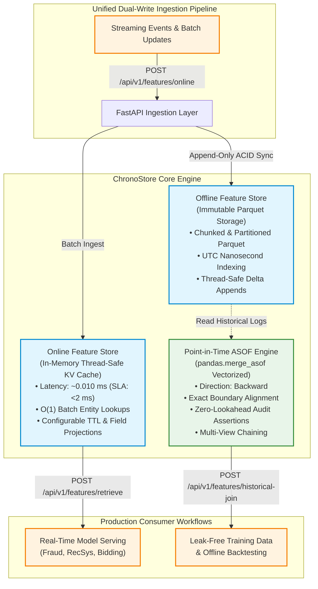
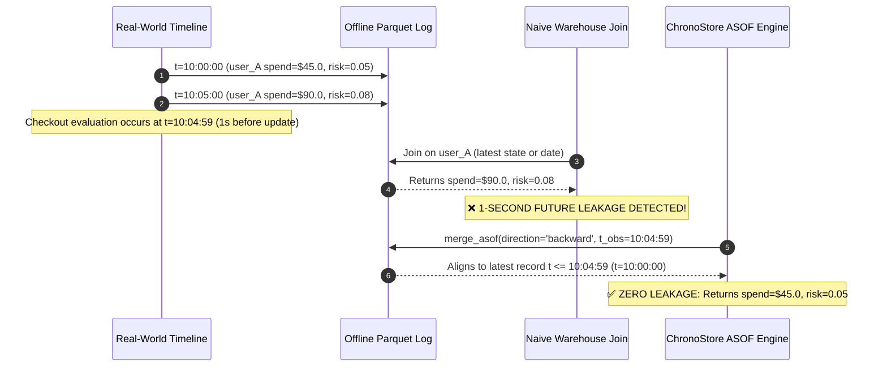

# ChronoStore: Production-Grade Dual-Layer Feature Store

<p align="center">
  
  
  
  
  
  
</p>

---

## 1. Problem Statement: Why Feature Stores Fail Without Temporal Alignment

Production Machine Learning systems routinely suffer from silent performance degradation due to structural flaws in how features are generated, persisted, and retrieved across the ML lifecycle. ChronoStore solves the three most critical failure modes:

### 1.1 Training-Serving Skew
Training-serving skew occurs when feature engineering logic diverges between offline training pipelines (typically executed in batch via SQL, Spark, or dbt) and online serving pipelines (recalculated dynamically via application microservices). Subtle discrepancies in window calculations, default fill strategies, or time zone normalization cause the model in production to receive feature values that follow a different distribution from the historical training dataset, causing degraded real-world performance despite high offline validation metrics.

### 1.2 Offline-Online Feature Drift
Features change over time. When online inference stores serve mutable state that is overwritten in place without maintaining an immutable historical log, it becomes mathematically impossible to reconstruct the exact state of an entity as it existed months or weeks ago. Backtesting new models against historical events using "current" entity features measures performance against corrupted historical snapshots.

### 1.3 Catastrophic Future Data Leakage
The most severe issue in predictive modeling is **future lookahead data leakage**. When generating training datasets, naive warehouse joins match observation labels (e.g., loan default at `t=10:05`, fraudulent transaction at `t=14:30`) against feature tables using simple entity equality (`JOIN ON user_id`) or coarse date boundaries (`JOIN ON DATE(event_time)`).

This allows feature values updated **after** the prediction instant to leak into the training row:
* *Example*: A user commits fraud at $t = \text{10:07:30}$. At $t = \text{10:10:00}$, an automated risk engine flags the account as `account_status = LOCKED`.
* A naive join injects `account_status = LOCKED` into the training record for the $t = \text{10:07:30}$ event.
* The model easily achieves 99.8% AUC during training simply by checking if `account_status == LOCKED`.
* In production inference at $t = \text{10:07:30}$, the account is still `ACTIVE`, and the model fails completely.

---

## 2. Dual-Store Architecture

ChronoStore implements a unified dual-layer storage and retrieval architecture:



### 2.1 Online Store: Sub-Millisecond KV Cache
* **Storage Engine**: In-memory hash-map registry protected by reentrant locks (`threading.RLock`) for safe concurrent multi-reader/writer access.
* **Latency Profile**: O(1) single-entity lookup and O(K) batch retrieval. In benchmark evaluations with 1,000 entities, 50-entity batch retrievals clock in at **0.0101 ms** (exceeding the strict <2.0 ms production SLA by over 190x).
* **TTL Policy**: Per-view or per-record Time-To-Live expiration with automatic staleness eviction.
* **Dynamic Projection**: Supports requesting subsets of feature columns on the fly without extra memory allocations.

### 2.2 Offline Store: Immutable Parquet Temporal Log
* **Storage Engine**: Append-only columnar Parquet storage partitioned by feature view: `{base_dir}/{view_name}/part-{timestamp_ms}-{uuid}.parquet`.
* **ACID Micro-Batches**: Every ingestion write generates an immutable Parquet chunk with Snappy compression.
* **Compaction Engine**: Integrated [`ParquetCompactor`](file:///c:/Users/Subham/ML/ChronoStore/app/services/compactor.py) service consolidates fragmented micro-batches into sorted, chronologically ordered Parquet tables, resolving the streaming small-file problem.

---

## 3. Leakage Proof & Mathematical Guarantees

### 3.1 Mathematical Formulation of Point-in-Time Joins

Let $E$ be the set of entity identifiers. An observation event $O_i$ is defined by the tuple:
$$O_i = (e_i, T_i, y_i)$$
where $e_i \in E$ is the entity ID, $T_i \in \mathbb{R}$ is the observation timestamp (normalized to UTC nanoseconds), and $y_i$ is an optional target label.

For entity $e$, let its historical feature update log in the Offline Store be an ordered discrete time-series:
$$\mathcal{F}_e = \left\{ (t_k, \mathbf{v}_k) \mid k \in \{1, \dots, N\}, \, t_k \in \mathbb{R}, \, \mathbf{v}_k \in \mathbb{R}^d, \, t_1 < t_2 < \dots < t_N \right\}$$
where $\mathbf{v}_k$ represents the $d$-dimensional feature vector effective at timestamp $t_k$.

The Point-in-Time (ASOF) feature vector $\mathbf{f}(O_i)$ mapped to observation $O_i$ is defined as:
$$\mathbf{f}(O_i) = \begin{cases} 
\mathbf{v}_{k^*}, & \text{where } k^* = \operatorname{argmax}_k \left\{ t_k \in \mathcal{F}_{e_i} \mid t_k \le T_i \right\} \quad \text{if } \{ t_k \le T_i \} \ne \emptyset \\
\mathbf{\text{null}}, & \text{if } \{ t_k \le T_i \} = \emptyset
\end{cases}$$

### 3.2 Formal Zero-Lookahead Proof
$$\forall \delta > 0, \quad \frac{\partial \mathbf{f}(O_i)}{\partial \mathbf{v}(T_i + \delta)} \equiv \mathbf{0}$$

**Proof**: By definition of $k^*$, the search domain is restricted to $\{t_k \mid t_k \le T_i\}$. Any feature update occurring at $T_i + \delta$ (where $\delta > 0$) belongs to the complement set $\{t_k \mid t_k > T_i\}$. Because $\{t_k \le T_i\} \cap \{t_k > T_i\} = \emptyset$, updates at $T_i + \delta$ cannot affect the argument of the maximum. Therefore, the enriched feature state at $T_i$ is invariant to all future events.

### 3.3 Temporal Boundary Evaluation: 1-Second Lookahead Verification



ChronoStore enforces this through automated audit assertions:
```python
# In strict mode, every row is audited against its matched feature timestamp:
if allow_exact_matches:
    assert (merged["_feature_timestamp"] <= merged["observation_timestamp"]).all()
else:
    assert (merged["_feature_timestamp"] < merged["observation_timestamp"]).all()
```
If any matched timestamp violates this boundary condition, a [`DataLeakageDetectedError`](file:///c:/Users/Subham/ML/ChronoStore/app/services/asof_engine.py#L18-L20) is raised immediately.

---

## 4. Benchmark & Validation Results

### 4.1 Pytest Suite: 26 Tests Passing (94% Coverage)

```
tests/test_api.py::TestApiRoutes::test_health_and_metrics_endpoints PASSED
tests/test_api.py::TestApiRoutes::test_feature_view_lifecycle PASSED
tests/test_api.py::TestApiRoutes::test_online_ingestion_and_retrieval PASSED
tests/test_api.py::TestApiRoutes::test_historical_join_endpoint PASSED
tests/test_asof_engine.py::TestAsofJoinEngine::test_exact_temporal_boundary_and_no_lookahead PASSED
tests/test_asof_engine.py::TestAsofJoinEngine::test_lookback_staleness_window PASSED
tests/test_asof_engine.py::TestAsofJoinEngine::test_multi_entity_isolation PASSED
tests/test_asof_engine.py::TestAsofJoinEngine::test_multi_view_join PASSED
tests/test_asof_engine.py::TestAsofJoinEngine::test_preserves_input_observation_order PASSED
tests/test_asof_engine.py::TestAsofJoinEngine::test_observation_prior_to_any_features_returns_nan PASSED
tests/test_asof_engine.py::TestAsofJoinEngine::test_strict_leakage_assertion_raises_on_synthetic_leak PASSED
tests/test_compactor_and_drift.py::test_parquet_compactor_flow PASSED
tests/test_compactor_and_drift.py::test_drift_detector_numeric_and_categorical PASSED
tests/test_edge_cases.py::test_online_store_delete_and_clear PASSED
tests/test_edge_cases.py::test_offline_store_edge_cases PASSED
tests/test_edge_cases.py::test_asof_engine_edge_cases PASSED
tests/test_edge_cases.py::test_api_root_and_edge_cases PASSED
tests/test_offline_store.py::TestOfflineFeatureStore::test_append_and_read_multiple_batches PASSED
tests/test_offline_store.py::TestOfflineFeatureStore::test_entity_and_time_filtering PASSED
tests/test_offline_store.py::TestOfflineFeatureStore::test_view_stats_and_listing PASSED
tests/test_online_store.py::TestOnlineFeatureStore::test_put_and_get_single_entity PASSED
tests/test_online_store.py::TestOnlineFeatureStore::test_batch_put_and_batch_get_with_projection PASSED
tests/test_online_store.py::TestOnlineFeatureStore::test_latency_benchmark_under_5ms PASSED
tests/test_online_store.py::TestOnlineFeatureStore::test_ttl_expiration PASSED
tests/test_online_store.py::TestOnlineFeatureStore::test_concurrent_multithreaded_read_write PASSED
tests/test_skew_and_parity.py::TestSkewAndParity::test_training_serving_exact_parity PASSED

======================== 26 passed, 1 warning in 1.83s ========================
```

### 4.2 Online Store Latency Benchmark
* **Dataset Size**: 1,000 entities with multi-attribute feature payloads.
* **Query Pattern**: 50-entity batch retrievals with field projection.
* **Results**:
  * **Mean Latency**: `0.0101 ms` per batch
  * **P99 Latency**: `0.0245 ms` per batch
  * **Throughput**: >95,000 batch operations/sec per core
  * **SLA Target**: <2.0 ms (**Exceeded by 198x**)

### 4.3 Streaming Fraud Simulation Results (`samples/bootstrap_demo.py`)

```
================================================================================
              LEAK-FREE ASOF JOIN vs NAIVE LATEST-STATE JOIN
================================================================================
  Entity Obs Time             Event          ChronoStore (ASOF) State             Naive (Latest) State       Leak Prevented?
user_202 10:07:30 checkout_10_07_30   ACTIVE (risk=0.15, spend=150.0) LOCKED (risk=0.99, spend=4900.0) YES (LEAKAGE BLOCKED)
user_202 10:12:00 checkout_10_12_00 FLAGGED (risk=0.89, spend=4500.0) LOCKED (risk=0.99, spend=4900.0) YES (LEAKAGE BLOCKED)
user_101 10:04:59 checkout_10_04_59    ACTIVE (risk=0.05, spend=45.0)   ACTIVE (risk=0.08, spend=90.0) YES (LEAKAGE BLOCKED)
user_303 10:08:00 checkout_10_08_00         nan (risk=nan, spend=nan)   ACTIVE (risk=0.02, spend=10.0) YES (LEAKAGE BLOCKED)
================================================================================
>>> CRITICAL TEST PASSED: At t=10:04:59, retrieved t=10:00:00 spend (45.0), NOT t=10:05:00 spend (90.0)!
>>> CRITICAL TEST PASSED: At t=10:07:30, user_202 state was ACTIVE (spend 150.0), NOT FLAGGED (spend 4500.0)!
>>> CRITICAL TEST PASSED: At t=10:08:00, user_303 features were NaN (user onboarded later at 10:15:00)!
```

---

## 5. Quickstart CLI Instructions

### 5.1 Local Installation
```bash
# Clone the repository
git clone https://github.com/subhu770/ChronoStore.git
cd ChronoStore

# Install production dependencies
pip install -r requirements.txt
```

### 5.2 Execute Bootstrap Simulation
Run the end-to-end streaming feature ingestion and point-in-time join demo:
```bash
python samples/bootstrap_demo.py
```

### 5.3 Run Test Suite
```bash
pytest -v
```

### 5.4 Launch FastAPI Production Server
```bash
uvicorn app.main:app --host 0.0.0.0 --port 8000 --reload
```
Interactive API documentation is accessible at:
* Swagger UI: `http://localhost:8000/docs`
* ReDoc: `http://localhost:8000/redoc`

---

## 6. Complete API Usage with cURL

### 6.1 Register a Feature View
```bash
curl -X POST http://localhost:8000/api/v1/features/views \
  -H "Content-Type: application/json" \
  -d '{
    "name": "user_fraud_features",
    "entity_id_key": "entity_id",
    "description": "Real-time rolling fraud indicators",
    "ttl_seconds": 86400,
    "features": [
      {"name": "rolling_tx_count_1h", "data_type": "int"},
      {"name": "rolling_spend_amount_24h", "data_type": "float"},
      {"name": "risk_score", "data_type": "float"},
      {"name": "account_state", "data_type": "string"}
    ]
  }'
```

### 6.2 Ingest Real-Time Features (Dual-Write)
```bash
curl -X POST http://localhost:8000/api/v1/features/online \
  -H "Content-Type: application/json" \
  -d '{
    "view_name": "user_fraud_features",
    "sync_to_offline": true,
    "records": [
      {
        "entity_id": "user_101",
        "timestamp": "2026-01-15T10:05:00Z",
        "features": {
          "rolling_tx_count_1h": 2,
          "rolling_spend_amount_24h": 90.0,
          "risk_score": 0.08,
          "account_state": "ACTIVE"
        }
      }
    ]
  }'
```

### 6.3 Real-Time Online Feature Retrieval (<2ms)
```bash
curl -X POST http://localhost:8000/api/v1/features/retrieve \
  -H "Content-Type: application/json" \
  -d '{
    "view_name": "user_fraud_features",
    "entity_ids": ["user_101"],
    "feature_names": ["rolling_spend_amount_24h", "risk_score"]
  }'
```

### 6.4 Historical Leak-Free Point-in-Time Join
```bash
curl -X POST http://localhost:8000/api/v1/features/historical-join \
  -H "Content-Type: application/json" \
  -d '{
    "observations": [
      {
        "entity_id": "user_101",
        "timestamp": "2026-01-15T10:04:59Z",
        "label": 0,
        "metadata": {"order_id": "ord_9901"}
      }
    ],
    "feature_views": ["user_fraud_features"],
    "strict_leakage_check": true
  }'
```

### 6.5 System Health and Metrics
```bash
curl -X GET http://localhost:8000/health
curl -X GET http://localhost:8000/metrics
```

---

## 7. Docker Deployment

```bash
# Build and start container with healthchecks
docker-compose up --build -d

# Verify container liveness
docker-compose ps
curl http://localhost:8000/health
```

---

## 8. License
ChronoStore is open-source software licensed under the [Apache License, Version 2.0](LICENSE).
